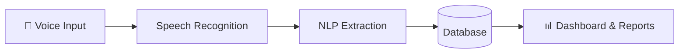

<div align="center">

# 🎙️ MeroHisab

### Speak your business. We'll keep the books.

**AI-powered, voice-first business management for small retailers**


</div>

---

## 📖 Overview

Small shopkeepers handle dozens of transactions a day, and most of them still rely on paper ledgers (*khata*) or memory. **MeroHisab** replaces that with something far more natural: **just say it.**

> *"Sold two kilos of rice to Ram for 300 rupees, he'll pay later."*

MeroHisab listens, understands, and records the sale, the customer, and the credit balance automatically, with no forms, no typing, and no accounting background required.

---

## ✨ Key Features

| | Feature | Description |
|---|---|---|
| 🎤 | **Voice-Based Recording** | Record sales, expenses, and payments using natural speech. |
| 🧠 | **AI-Powered Understanding** | Automatically extracts items, amounts, and customer names from voice input. |
| 👥 | **Customer Management** | Maintain customer profiles and track credit (udhaar) balances. |
| 💸 | **Transaction Tracking** | View, edit, and manage every sale, expense, and payment in one place. |
| 📊 | **Dashboard & Reports** | Get a clear picture of daily activity and financial summaries. |

---

## 🔄 How It Works



1. **Speak**: the shopkeeper describes a transaction in natural language.
2. **Understand**: speech is transcribed and key details are extracted by the NLP engine.
3. **Record**: the transaction and customer balance are saved automatically.
4. **Review**: sales, expenses, and credit are visible on the dashboard.

---

## 🛠️ Technology Stack

| Layer | Technologies |
|---|---|
| **Frontend** | React, JavaScript, CSS |
| **Backend** | Python |
| **AI / NLP** | Speech Recognition, Natural Language Processing |
| **Database** | Project-configured database |

---

## 📁 Project Structure

```
MeroHisab/
├── frontend/      # React web application
├── backend/       # Python API and AI/NLP services
├── README.md
└── .gitignore
```

---

## 🚀 Getting Started

### Prerequisites

- [Node.js](https://nodejs.org/) and npm
- [Python 3](https://www.python.org/)
- Git

### Installation

```bash
# Clone the repository
git clone https://github.com/MeroHisab/MeroHisab.git
cd MeroHisab
```

Then follow the setup instructions in each directory:

- 🖥️ [`frontend/`](./frontend): React application setup
- ⚙️ [`backend/`](./backend): Python server and AI services setup

---

## 🗺️ Roadmap

- [x] Project setup and architecture
- [x] Voice input and transaction extraction
- [ ] Customer credit management
- [ ] Dashboard and financial reports
- [ ] Nepali language voice support
- [ ] Mobile-friendly experience

> Update this checklist to match your actual progress.

---

## 🎓 About the Project

MeroHisab is a **university group project** built to make digital bookkeeping simpler and more accessible for small retailers, especially those who are not comfortable with traditional accounting software.

---

## 👥 Team 
Priyanka Khatri & Smriti Basnet 


<!-- Add members like this:
| Name | Role | GitHub |
|---|---|---|
| Your Name | Backend / AI | [@username](https://github.com/username) |
-->

---

<div align="center">

**Made with ❤️ for small businesses**

⭐ Star this repo if you like the idea!

</div>